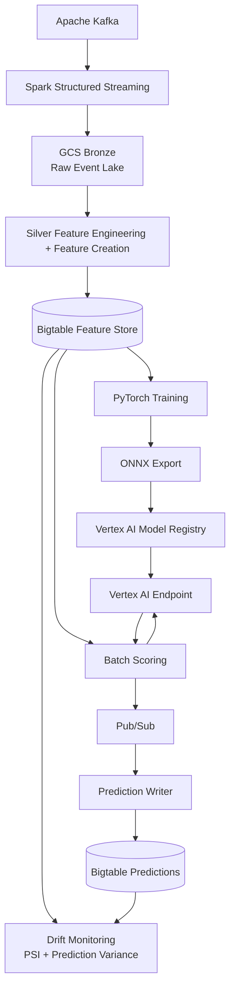

# Supply Chain Intelligence Platform

<p align="center">
  
  
</p>

---

[Status: Work in Progress]

This project demonstrates an end-to-end machine learning platform to predict the risk of an inventory shortage. 

The historical training data is simulated to create realistic warehouse, inventory, supplier, and demand behavior. 

The focus of the project is the platform architecture and MLOps lifecycle rather than validation of inventory data.

---

## [Demo](https://www.youtube.com/watch?v=fpe3sHeRTNs)

The video was recorded from the code tagged [`demo-2026-06`](https://github.com/ryanhillman/supply-chain-intelligence-platform/releases/tag/demo-2026-06).

---

## Business Problem

Inventory shortages and excess stock are two of the most operationally expensive failure modes in distribution-scale supply chains. 

Inventory shortages create lost revenue while excess inventory increases carrying costs.

---

## Architecture Diagram


---

## Architecture Walkthrough

Kafka ingests inventory, supplier, shipment, purchase order, and demand events generated by the simulation layer.

Spark Structured Streaming consumes Kafka topics and writes immutable raw events to the Bronze layer in Google Cloud Storage.

A scheduled Silver processing job aggregates Bronze data into feature snapshots containing 29 supply-chain features for each warehouse-SKU entity.

Feature snapshots are stored in Google Cloud Bigtable, which serves as the online feature store for model training and inference.

A PyTorch shortage prediction model is trained on historical feature data and exported to ONNX for portable deployment.

The model is deployed to Vertex AI Endpoints using a containerized FastAPI application powered by ONNX Runtime.

The batch scoring pipeline reads features from Bigtable, generates predictions through Vertex AI, and publishes results to Pub/Sub.

A prediction writer consumes Pub/Sub messages and stores shortage-risk predictions back into Bigtable for downstream consumers.

A drift monitoring service evaluates live feature distributions against training baselines and reports potential model degradation.

GCS, Bigtable, Vertex AI, Artifact Registry, Pub/Sub, and all IAM bindings were provisioned with Terraform.

---

## Machine Learning Pipeline

### Problem Formulation

The model predicts whether a `(warehouse_id, sku_id)` entity is at risk of a stockout within the next 7 days. Predictions are returned as:

- **shortage_prob_7d** — probability of a shortage event
- **stockout_risk_score** — closed-form P(stockout ≤ 7d) under a Normal approximation of days-to-zero, computed from current stock, 7-day average sales and their spread

### Features

The training dataset is built from Silver-layer snapshots containing 29 engineered supply chain features across six domains:

- Inventory position
- Demand velocity
- Demand forecasts
- Supplier performance
- Risk metrics
- Data lineage

The model consumes 21 numeric features along with warehouse and SKU embeddings.

### Model

The shortage predictor is implemented in PyTorch as a feed-forward neural network with learned warehouse and SKU embeddings.

**Key characteristics:**

- 21 engineered numeric features
- Warehouse embeddings
- SKU embeddings
- Single output: the shortage probability. The risk score is a closed-form formula computed at scoring time, not a second head

After training, the model is exported to ONNX and validated with ONNX Runtime before deployment.

### Training Data

Historical training data is generated using a synthetic supply-chain simulator that models:

- Demand seasonality
- Supplier reliability variation
- Lead-time fluctuations
- Demand spikes
- Inventory replenishment behavior

The simulator generates 365 days of history across 6 warehouses and 20 SKUs, producing approximately 43,800 training records.

### Training Configuration

- Temporal train / validation / test split
- 7-day shortage prediction horizon
- AdamW optimizer
- Early stopping on validation performance
- ONNX export for production inference
  
---

## Model Serving Pipeline

1. Feature snapshots are read from Bigtable; rows whose last Silver write is older than 48 hours are skipped rather than scored on stale features.
2. The batch scorer constructs feature vectors and invokes a Vertex AI endpoint.
3. The serving container performs inference using ONNX Runtime.
4. Prediction results are published to Pub/Sub.
5. The prediction writer stores predictions back into Bigtable.
6. Drift monitoring evaluates live feature distributions against training baselines.

### Serving Components

- Vertex AI Model Registry
- Vertex AI Endpoint
- FastAPI Serving Container
- ONNX Runtime
- Pub/Sub Prediction Pipeline
- Bigtable Prediction Store

---

## Drift Monitoring

The drift monitor compares the live feature distribution (read from Bigtable) against the training split's own distribution (decile bins of the raw training split, written next to the model as `drift_reference.json` so the reference travels with the model, and both sides share units) using **Population Stability Index (PSI)**. PSI thresholds follow industry convention:

| PSI | Interpretation |
|---|---|
| < 0.10 | Stable — no action required |
| 0.10 – 0.20 | Warning — investigate distribution shift |
| ≥ 0.20 | Trigger — flagged as a retraining recommendation |

Four features are monitored: `days_of_supply`, `sales_7d`, `avg_daily_sales_7d`, and `supplier_reliability`. Two additional triggers run alongside feature PSI: **prediction variance collapse** (a `shortage_prob_7d` standard deviation below 0.01 across the scored population means the model has lost discriminative power) and **baseline divergence** (if the model agrees with the rule-based `risk__reorder_urgency` heuristic on more than 95% of entities, it isn't adding signal over the heuristic). Any one of the three is sufficient to recommend retraining.

The monitor produces a structured JSON report (`drift_report.json`) and can optionally emit the same metrics to Cloud Monitoring. All three triggers are advisory — the report flags a retraining recommendation for a human to act on; nothing in the scoring or promotion scripts reads it back to block anything automatically yet.

---

## Teardown

Deployed models and the Bigtable node bill while idle. Between sessions, undeploy the endpoint's models (the endpoint resource stays):

```
python model_serving/scripts/deploy.py undeploy --project <project> --endpoint <endpoint-resource-name>
```

The Bigtable instance can also be destroyed. After `terraform apply` recreates it, re-running the Silver job repopulates it from Bronze.

---

## Key Design Decisions

The stack (Kafka, Spark, Bigtable, PyTorch, Vertex AI) was selected for hands-on experience with each technology, not because 6 warehouses and 20 SKUs require it. The system is sized for the stack, not the data: 120 feature rows fit in Postgres or a Parquet file, and the model could be scored inside the batch job instead of behind an endpoint. On the same test split, LightGBM matches the PyTorch model (AUPRC 0.740 vs 0.732, Brier 0.075 vs 0.076) and is the recommended production choice. The MLP is retained as the learning artifact and comparison row. The decision records document each choice, including designs that were later corrected:

- [ADR-003 — Bigtable as the online feature store](docs/adr/ADR-003-bigtable-feature-store.md)
- [ADR-004 — PyTorch shortage predictor](docs/adr/ADR-004-pytorch-shortage-predictor.md)
- [ADR-005 — Vertex AI serving and prediction storage](docs/adr/ADR-005-vertex-ai-serving.md)
