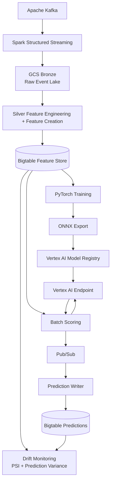

# Supply Chain Intelligence Platform

<p align="center">
  
  
</p>

---

[Status: Work in Progress]

This project demonstrates an end-to-end machine learning platform to predict the risk of an inventory shortage. 

The historical training data is simulated to create realistic warehouse, inventory, supplier, and demand behavior. 

---

## [Demo](https://www.youtube.com/watch?v=fpe3sHeRTNs)

The video was recorded from the code tagged [`demo-2026-06`](https://github.com/ryanhillman/supply-chain-intelligence-platform/releases/tag/demo-2026-06).

---

## Business Problem

Inventory shortages and excess stock are two of the most expensive operational failures in large-scale supply chains.

Inventory shortages create lost revenue while excess inventory increases carrying costs.

---

## Architecture Diagram


---

## Architecture Walkthrough

Kafka ingests inventory, supplier, shipment, purchase order, and demand events generated by the simulation layer.

Spark Structured Streaming consumes Kafka topics and writes immutable raw events to the Bronze layer in Google Cloud Storage.

A Silver batch job computes, as of a given date, a feature snapshot for each warehouse-SKU entity from Bronze.

Feature snapshots are stored in Google Cloud Bigtable, which serves as the online feature store for scoring and drift monitoring.

A PyTorch shortage prediction model is trained on rows the training sampler builds from Bronze and exported to ONNX for portable deployment.

The model is deployed to Vertex AI Endpoints using a containerized FastAPI application powered by ONNX Runtime.

The batch scoring pipeline reads features from Bigtable, generates predictions through Vertex AI, and publishes results to Pub/Sub.

A prediction writer consumes Pub/Sub messages and stores shortage-risk predictions back into Bigtable for downstream consumers.

A drift monitor compares live feature distributions with the training data and reports potential model degradation.

GCS, Bigtable, Vertex AI, Artifact Registry, Pub/Sub, and all IAM bindings were provisioned with Terraform.

---

## Machine Learning Pipeline

### Problem Formulation

The model predicts whether a `(warehouse_id, sku_id)` entity is at risk of a stockout within the next 7 days. The scorer publishes two values per entity:

- **shortage_prob_7d** — the model's probability of a stockout within 7 days
- **stockout_risk_score** — the baseline: closed-form P(stockout ≤ 7d) under a Normal approximation, computed from current stock and the 7-day mean and standard deviation of daily sales. It is not a model output.

### Features

Silver writes 29 columns per warehouse-SKU entity in six groups:

- Inventory position
- Demand velocity
- Demand signals
- Supplier performance
- Risk metrics
- Data lineage

Five are reserved and left empty: the three demand-forecast columns and the two prediction columns. The model takes 21 numeric features plus the warehouse and SKU IDs, for which it learns embeddings.

### Model

The shortage predictor is a PyTorch feed-forward network (MLP) with learned warehouse and SKU embeddings and one output, the shortage probability. After training, it is exported to ONNX and its output is checked against PyTorch's with ONNX Runtime.

### Training Data

Training and scoring data come from one simulated supply chain (`simulation/world.py`) that models:

- Demand seasonality
- Supplier reliability variation
- Lead-time fluctuations
- Demand spikes
- Inventory replenishment behavior

The Kafka producer replays 365 simulated days for 6 warehouses and 20 SKUs, about 200,000 events, into Bronze. The training sampler builds 39,360 labeled rows from Bronze, one per warehouse-SKU-day, leaving out the first 30 days (feature warm-up) and the last 7 (no outcome yet), with the same feature windows Silver uses for scoring.

### Training Configuration

- Time-based 70 / 15 / 15 train / validation / test split, with a 7-day gap before each cutoff
- AdamW optimizer
- Early stopping on validation AUPRC

### Test Results

Test split of the replayed world: the last 15% of sample dates, 6,000 rows, 21.8% of them followed by a stockout within 7 days. The in-stock columns cover the 5,464 rows with `current_qty > 0`, leaving out rows that are already out of stock.

| Model | AUC-ROC | AUPRC | Brier | In-stock AUC-ROC | In-stock AUPRC | In-stock Brier |
|---|---|---|---|---|---|---|
| Normal-approximation formula (baseline) | 0.874 | 0.639 | 0.161 | 0.890 | 0.554 | 0.149 |
| PyTorch MLP | 0.941 | 0.838 | 0.079 | 0.934 | 0.774 | 0.072 |
| LightGBM (comparison only) | 0.945 | 0.849 | 0.078 | 0.938 | 0.791 | 0.070 |

MLP and LightGBM rows are the mean of five training runs with different random seeds. LightGBM was better by small margins.

The model was built in PyTorch for hands-on experience.

---

## Model Serving Pipeline

1. Feature snapshots are read from Bigtable; rows whose last Silver write is older than 48 hours are skipped rather than scored on stale features.
2. The batch scorer constructs feature vectors and invokes a Vertex AI endpoint.
3. The serving container performs inference using ONNX Runtime.
4. Prediction results are published to Pub/Sub.
5. The prediction writer stores predictions back into Bigtable.

---

## Drift Monitoring

The drift monitor compares live features in Bigtable with the training split using the Population Stability Index (PSI). Its reference bins (deciles of the raw training split) are written next to the model as `drift_reference.json`, so the reference travels with the model. PSI thresholds:

| PSI | Interpretation |
|---|---|
| < 0.10 | Stable — no action required |
| 0.10 – 0.20 | Warning — investigate distribution shift |
| ≥ 0.20 | Trigger — flagged as a retraining recommendation |

Retraining is recommended when any of these trips:

- PSI ≥ 0.20 on `days_of_supply`, `sales_7d` or `avg_daily_sales_7d`
- Prediction variance collapse: standard deviation of `shortage_prob_7d` or `stockout_risk_score` below 0.01 across scored entities
- Baseline divergence: the model agrees with the `risk__reorder_urgency` rule on more than 95% of entities

`supplier_reliability` is computed per warehouse, so a snapshot holds only six values, too few for PSI. Each warehouse's value is checked against its training p1–p99, and an out-of-range warehouse is reported as a warning, not a trigger.

The monitor writes `drift_report.json` and can emit its metrics to Cloud Monitoring. The report is advisory: nothing reads it back to block scoring or promotion.

---

## Teardown

Deployed models and the Bigtable node bill while idle. Between sessions, undeploy the endpoint's models (the endpoint resource stays):

```
python model_serving/scripts/deploy.py undeploy --project <project> --endpoint <endpoint-resource-name>
```

The Bigtable instance can also be destroyed. After `terraform apply` recreates it, re-running the Silver job repopulates it from Bronze.
