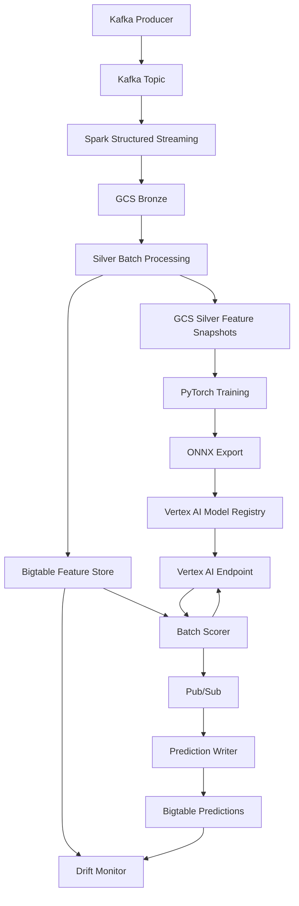

# Supply Chain Intelligence Platform


---

An end-to-end supply chain intelligence platform built on GCP. The system ingests real-time warehouse inventory events via Kafka, processes them through Spark Structured Streaming into a two-layer GCS data lake, computes and stores features in a Bigtable online feature store, trains a PyTorch shortage prediction model, exports it to ONNX, deploys it to Vertex AI, and monitors for feature drift in production. All infrastructure is managed with Terraform.

---

## Project Scope

This project demonstrates an end-to-end machine learning platform for supply-chain shortage-risk scoring. The historical training data is generated from a domain-grounded synthetic simulation designed to create realistic warehouse, inventory, supplier, and demand behavior. The focus of the project is the platform architecture, deployment workflow, feature engineering, model serving, monitoring, and MLOps lifecycle rather than validation on real enterprise supply-chain data.

---

## Table of Contents

- [Project Scope](#project-scope)
- [Business Problem](#business-problem)
- [Key Features](#key-features)
- [Architecture Diagram](#architecture-diagram)
- [Architecture Walkthrough](#architecture-walkthrough)
- [Technology Stack](#technology-stack)
- [Machine Learning Pipeline](#machine-learning-pipeline)
- [Model Serving Pipeline](#model-serving-pipeline)
- [Drift Monitoring](#drift-monitoring)
- [Infrastructure as Code](#infrastructure-as-code)
- [Project Structure](#project-structure)
- [Key Design Decisions](#key-design-decisions)
- [Architectural Tradeoffs](#architectural-tradeoffs)
- [Validation Results](#validation-results)
- [Demo Video](#demo-video)
- [Future Improvements](#future-improvements)

---

## Business Problem

Inventory stockouts and excess safety stock are two of the most operationally expensive failure modes in distribution-scale supply chains. Stockouts cause lost revenue and deferred demand; excess stock increases carrying cost, spoilage risk, and working capital drag. Neither can be managed effectively with threshold-based reorder rules alone, because reorder points are static and cannot adapt to shifting demand velocity, supplier reliability variance, or seasonal patterns.

This platform explores how learned shortage-risk scoring can augment traditional inventory planning approaches, scoring every warehouse-SKU pair on a 7-day stockout probability horizon. Predictions are served from a low-latency online endpoint and written back to the feature store so downstream systems — replenishment automation, buying dashboards, alerting pipelines — can consume them without building their own inference infrastructure.

---

## Key Features

- **Real-time ingestion** via Apache Kafka with Spark Structured Streaming consumer writing to GCS Bronze in exactly-once semantics
- **Two-layer data lake** (Bronze / Silver) with automated feature engineering across 31 columns per entity
- **Online feature store** on Google Cloud Bigtable — 6 column families, single-digit millisecond read latency, row key designed for warehouse-SKU access patterns
- **PyTorch shortage predictor** with warehouse/SKU embeddings and dual output heads, trained on domain-grounded synthetic supply-chain history (365 days × 6 warehouses × 20 SKUs), exported to self-contained ONNX opset 17 for portable deployment
- **Vertex AI Model Registry** with versioned artifact tracking, evaluation metrics, and champion/challenger deployment pattern
- **FastAPI serving container** loading ONNX Runtime at startup, containerized and hosted on Vertex AI with autoscaling configuration
- **Pub/Sub prediction pipeline** — batch scorer publishes scored entities as messages; prediction writer drains the subscription and mutates Bigtable
- **PSI-based drift monitor** comparing live feature distributions against training baselines, with a configurable retraining gate
- **Terraform-managed infrastructure** — GCS, Bigtable, Vertex AI, Artifact Registry, Pub/Sub, and all IAM bindings declared in HCL

---

## Architecture Diagram


---

## Architecture Walkthrough

### Ingestion Layer

Warehouse inventory events are produced to Apache Kafka by a Python producer. Spark Structured Streaming consumes these events in micro-batches, applies schema validation, and writes raw Parquet files to the **GCS Bronze** layer partitioned by event date. The Bronze layer serves as the immutable, append-only record of all ingested events — it is never modified, only appended.

### Feature Layer

A scheduled Silver batch job reads from Bronze, applies aggregation logic across configurable rolling windows (7-day, 30-day), and produces the **GCS Silver** layer — one Parquet file per snapshot date containing one row per `(warehouse_id, sku_id)` entity with 31 pre-computed feature columns. Silver rows are simultaneously written to **Google Cloud Bigtable** for low-latency online serving, using `{warehouse_id}#{sku_id}` row keys with pre-split ranges across the key space to distribute tablet load.

### ML Pipeline

The training pipeline reads Silver snapshots across a temporal window to construct a labeled dataset. Labels are derived from future inventory state: an entity is labeled a shortage if `days_of_supply ≤ 7` at the forecast horizon. A **PyTorch MLP** is trained with dual-head loss (BCEWithLogitsLoss for shortage probability, MSELoss for risk score) with class-imbalance weighting to address the natural scarcity of shortage events. After training, the model is exported to **ONNX opset 17** via `torch.onnx.export`, enabling deployment without a PyTorch dependency at inference time.

The training dataset is produced by a **synthetic supply-chain simulation engine** (`phase4/datasets/synthetic_generator.py`) that generates 365 days of realistic per-entity history across 6 warehouse profiles and 20 SKU archetypes, matching the exact column contract of the Bronze/Silver pipeline. The generator models demand seasonality, supplier reliability variation, lead-time noise, demand spikes, and inventory replenishment — producing a diverse 43,800-row training dataset with a ~20% positive label rate. In production, this generator is an additive bootstrap path; it does not replace the Bronze → Spark → Silver pipeline, which remains the primary data path once sufficient real inventory history accumulates.

### Serving Layer

The trained ONNX model is registered in **Vertex AI Model Registry** with versioned artifact storage in GCS. A containerized **FastAPI** application — bundling the ONNX Runtime, a `StandardScaler` preprocessor, and the feature vocabulary — is deployed to a Vertex AI Endpoint. The batch scorer scans Bigtable, builds scaled feature vectors, and calls the endpoint in parallel batches. Prediction results are published to **Cloud Pub/Sub** and consumed by the prediction writer, which writes `shortage_prob_7d` and `stockout_risk_score` back into the `predictions` column family of the same Bigtable table, co-locating features and predictions for downstream consumers.

---

## Technology Stack

| Layer | Technology | Version |
|---|---|---|
| Event streaming | Apache Kafka | 3.x |
| Stream processing | Apache Spark Structured Streaming | 3.x |
| Object storage | Google Cloud Storage | — |
| Online feature store | Google Cloud Bigtable | — |
| ML framework | PyTorch | 2.x |
| Model serialization | ONNX | opset 17 |
| Model inference | ONNX Runtime | 1.19.2 |
| Model serving API | FastAPI + Uvicorn | 0.115 / 0.32 |
| Model registry | Vertex AI Model Registry | — |
| Model hosting | Vertex AI Endpoints | n1-standard-2 |
| Prediction pipeline | Google Cloud Pub/Sub | — |
| Container registry | Artifact Registry | — |
| Infrastructure | Terraform + Google Provider | ≥1.5 / ~5.40 |
| Containerization | Docker | — |
| Language | Python | 3.12 |

---

## Machine Learning Pipeline

### Problem Formulation

Binary classification: given the current feature snapshot of a `(warehouse_id, sku_id)` entity, predict whether a stockout will occur within the next 7 days. Output is a calibrated probability `P(stockout ≤ 7d)` and a derived risk score.

### Feature Engineering

Silver features are grouped across 6 semantic families:

| Family | Columns | Description |
|---|---|---|
| `inventory` | `current_qty`, `reorder_point`, `days_of_supply`, ... | Current stock position |
| `velocity` | `sales_7d`, `avg_daily_sales_7d`, `sales_30d`, ... | Demand velocity (rolling windows) |
| `demand` | `demand_forecast_7d`, `demand_forecast_30d`, ... | Forward-looking demand signals |
| `supplier` | `lead_time_days`, `supplier_reliability`, ... | Supply-side risk factors |
| `risk` | `shortage_prob_7d`, `stockout_risk_score` | Model output targets |
| `lineage` | `ingest_timestamp`, `source_topic` | Audit and replay metadata |

The Silver layer stores 31 columns total across the six families above. Of these, the model consumes 21 numeric features (15 raw Silver columns plus 6 engineered interaction features) plus warehouse and SKU embeddings. The feature engineering step (`feature_engineer.py`) applies interaction terms, ratio features, and log transforms before scaling with a fitted `StandardScaler`. The preprocessor is serialized alongside the ONNX model and applied identically at training and inference time.

### Model Architecture

A 3-layer MLP with warehouse/SKU embeddings and dual output heads:

```
Input: 21 numeric features (StandardScaler-transformed)
       + warehouse_id embedding (6 warehouses, dim=3)
       + sku_id embedding       (20 SKUs, dim=5)
  → Linear(29 → 64) → BN → ReLU → Dropout(0.3)
  → Linear(64 → 32) → BN → ReLU → Dropout(0.2)
  → Linear(32 → 16) → BN → ReLU

  Head 1: Linear(16→1) → logit  (BCEWithLogitsLoss, shortage_prob_7d)
  Head 2: Linear(16→1) → Sigmoid (MSELoss against days_of_supply proxy, stockout_risk_score)
```

The 21 numeric features consist of 15 raw Bronze/Silver columns plus 6 engineered interaction features (days_of_supply, effective_supply, buffer_ratio, demand_cv, supply_coverage_days, replenishment_gap). Class imbalance is addressed with `pos_weight = n_negative / n_positive` passed to BCEWithLogitsLoss.

### Training Configuration

- Temporal train/val/test split (no data leakage across time boundaries)
- Label: `days_of_supply ≤ 7` at the 7-day forecast horizon
- Optimizer: Adam, learning rate 1e-3 with ReduceLROnPlateau
- Early stopping on validation AUPRC

### ONNX Export

Post-training, the model is exported to ONNX opset 17 with dynamic batch axis. External weight data is explicitly consolidated into a single self-contained `.onnx` file (no sidecar) before upload, ensuring the serving container can load the model from a single GCS object. The ONNX graph is validated with ONNX Runtime before registration to catch shape mismatches at export time rather than at inference time.

---

## Model Serving Pipeline

### Champion / Challenger Deployment

New model versions are deployed at 0% traffic as **challengers**. A smoke test validates predictions against live Bigtable rows. Automated metric comparison gates promotion: the challenger must exceed the champion on AUPRC, AUC-ROC, and Brier score before traffic is shifted. This prevents silent model regressions from reaching production scoring.

### Serving Container

The FastAPI container is purpose-built for ONNX Runtime inference:

- Loads `model.onnx` and `preprocessor.pkl` from GCS at startup
- Applies `StandardScaler` and `engineer_features()` identically to the training path
- Exposes `/predict` (batch) and `/health` endpoints
- Runs ONNX Runtime in CPU mode — the CPU-only `onnxruntime` package is ~25 MB vs ~600 MB for the CUDA variant; no GPU is needed for tabular inference at this throughput

### Batch Scoring Pipeline

```
Bigtable scan → feature vector construction → endpoint.predict() → Pub/Sub publish → Bigtable mutate
```

The batch scorer scans all `(warehouse_id, sku_id)` entities from Bigtable, applies the preprocessing pipeline locally to build feature matrices, calls the Vertex AI Endpoint in configurable batch sizes, publishes each scored entity as a structured Pub/Sub message, and the prediction writer drains the subscription into the `predictions` column family. This decoupled architecture allows the scorer and writer to scale independently.

---

## Drift Monitoring

The drift monitor compares the live feature distribution (read from Bigtable) against the training baseline (stored in the fitted `StandardScaler`) using **Population Stability Index (PSI)**. PSI thresholds follow industry convention:

| PSI | Interpretation |
|---|---|
| < 0.10 | Stable — no action required |
| 0.10 – 0.20 | Warning — investigate distribution shift |
| ≥ 0.20 | Trigger — retraining gate activated |

Four features are monitored: `days_of_supply`, `sales_7d`, `avg_daily_sales_7d`, and `supplier_reliability`. In addition to feature PSI, the monitor checks **prediction variance collapse** — a `shortage_prob_7d` standard deviation below 0.01 across the scored population indicates the model has lost discriminative power and retraining is required regardless of feature PSI.

The monitor produces a structured JSON report (`drift_report.json`) suitable for ingestion by Cloud Monitoring or an external observability platform.

---

## Infrastructure as Code

All GCP resources are declared in Terraform and version-controlled. No resources were created through the GCP Console.

```
infrastructure/gcp/
├── backend.tf          # GCS remote state backend
├── providers.tf        # Google provider ~5.40 pin
├── variables.tf        # Parameterized inputs
├── main.tf             # GCS bucket, Bigtable instance + table, GC policies, Spark SA + IAM
├── vertex_ai.tf        # Artifact Registry, Vertex AI endpoint, serving SA + IAM
├── pubsub.tf           # Prediction pipeline topics + subscriptions
└── outputs.tf          # Resource names consumed by application scripts
```

**Key infrastructure decisions:**

- Remote state in GCS with uniform bucket-level access and no public access
- Bigtable row key split points (`W-2`, `W-4`, `W-6`) pre-declared at table creation to distribute tablet load without hot-spotting
- GC policies per column family — `inventory` keeps 1 version (latest snapshot), `predictions` keeps 3 versions (rollback window), `supplier` retains 90 days (long lead time history)
- All IAM bindings are bucket-scoped or resource-scoped — no broad `Editor` or project-level `objectAdmin` grants
- `vertex_deployer_email` variable gates `serviceAccountUser` binding on the Vertex SA to a single principal, declared in `terraform.tfvars` and never committed

---

## Project Structure

```
supply-chain-platform/
│
├── kafka/                          # Ingestion layer
│   ├── producer/                   # Inventory event simulator and producer
│   └── docker-compose.yml          # Kafka + Zookeeper local cluster
│
├── spark/                          # Stream and batch processing
│   ├── jobs/
│   │   ├── bronze_ingestion.py     # Structured Streaming → GCS Bronze
│   │   ├── silver_batch.py         # Bronze → GCS Silver (batch)
│   │   └── silver_feature_engineering.py  # 31-column feature computation
│   ├── utils/                      # Schema definitions, GCS helpers
│   ├── Dockerfile
│   └── docker-compose.spark.yml
│
├── phase4/                         # ML training and ONNX export
│   ├── datasets/
│   │   ├── bronze_temporal_sampler.py  # GCS Bronze → (feature_rows, inv_events)
│   │   ├── synthetic_generator.py      # Simulation engine — bootstrap data path
│   │   ├── label_generator.py          # 7-day stockout labels from inv_events
│   │   ├── feature_engineer.py         # 6 derived features + leakage controls
│   │   └── dataset_builder.py          # Orchestrates both data paths
│   ├── training/                   # PyTorch model, dual-head loss, trainer
│   ├── inference/                  # ONNX export (self-contained), local predictor
│   ├── evaluation/                 # AUC-ROC, AUPRC, Brier, per-warehouse breakdown
│   └── scripts/                    # generate_data, build_dataset, train, evaluate
│
├── phase5/                         # Model registry, serving, and prediction pipeline
│   ├── registry/                   # Vertex AI model registration and promotion
│   ├── serving/
│   │   └── container/              # FastAPI + ONNX Runtime serving image
│   ├── pipeline/                   # Batch scorer, feature client, prediction writer
│   ├── monitoring/                 # PSI drift monitor
│   ├── scripts/                    # CLI entry points: register, deploy, score, monitor
│   └── ADR-005-vertex-ai-serving.md
│
├── infrastructure/
│   └── gcp/                        # Terraform — all GCP resources
│
└── docs/
    └── adr/                        # Architecture Decision Records
        ├── ADR-003-bigtable-feature-store.md
        └── ADR-004-pytorch-shortage-predictor.md
```

---

## Key Design Decisions

### ADR-003 — Bigtable as Online Feature Store

Bigtable was selected over Redis, Firestore, and AlloyDB as the online feature store after evaluating read latency, write throughput, operational overhead, and GCP-native integration.

The row key `{warehouse_id}#{sku_id}` is designed for two primary access patterns: point lookups by the inference path (single-row reads by full key) and range scans by the drift monitor (prefix scan on `warehouse_id`). Column family separation between `inventory`, `velocity`, `demand`, `supplier`, `risk`, and `lineage` allows the inference path to read only the families required for scoring, reducing read amplification.

Pre-declared split keys (`W-2`, `W-4`, `W-6`) distribute the key space across tablet servers at table creation time, avoiding the cold-start hot-spotting that occurs when splits are inferred from write volume alone.

[Full decision record →](docs/adr/ADR-003-bigtable-feature-store.md)

### ADR-004 — PyTorch Shortage Predictor

PyTorch was selected over XGBoost/LightGBM for its native `torch.onnx.export` path, which produces a validated ONNX graph without third-party conversion tooling. The MLP architecture was chosen over tree ensembles to support future extension to sequence models (LSTM/Transformer) on time-series inventory trajectories without pipeline re-architecture.

Class imbalance is addressed with BCEWithLogitsLoss and a `pos_weight` parameter set to `n_negative / n_positive` (clamped to [0.1, 10.0]). In a well-managed supply chain, shortage events are rare — positive-label rate is approximately 15–20%. Standard binary cross-entropy applied naively would pressure the model to predict non-shortage for all inputs; `pos_weight` rescales the loss contribution of positive examples to keep gradient signal balanced across both classes.

[Full decision record →](docs/adr/ADR-004-pytorch-shortage-predictor.md)

### ADR-005 — Vertex AI Serving Architecture

The serving architecture decouples model deployment from prediction scoring. Vertex AI manages the serving container lifecycle, autoscaling, and traffic splitting; the application layer drives batch scoring and Pub/Sub delivery independently. This separation allows the model to be replaced (via champion/challenger promotion) without modifying the scoring or prediction-write pipelines.

ONNX Runtime was chosen over PyTorch serving (`torch.jit`, TorchServe) to eliminate the PyTorch dependency from the production serving image. The CPU-only ONNX Runtime wheel is ~25 MB; the GPU PyTorch wheel exceeds 2 GB. For tabular MLP inference at batch-scoring throughput, CPU inference is sufficient and significantly reduces container build time, image size, and per-prediction cost.

[Full decision record →](phase5/ADR-005-vertex-ai-serving.md)

---

## Architectural Tradeoffs

### Bronze → Silver Batch vs. Streaming

The Bronze → Silver step is implemented as a scheduled batch job rather than a second streaming layer. This is a deliberate tradeoff: streaming Silver would reduce feature staleness but significantly increase operational complexity (stateful aggregation, watermark management, late-arrival handling). For a 7-day shortage horizon, feature freshness measured in hours rather than seconds is acceptable, and batch Silver is operationally far simpler to reason about, debug, and backfill.

### Pub/Sub Decoupling for Prediction Writes

The scoring pipeline publishes predictions to Pub/Sub rather than writing directly to Bigtable from the scorer process. This decoupling adds one hop but provides three concrete benefits: the scorer and writer can be scaled independently; failed writes are retried by the subscription without re-scoring; and the prediction messages can be fanned out to additional consumers (alerting systems, downstream ML features) without modifying the scorer.

### Single Bigtable Table vs. Separate Prediction Table

Predictions are written to a `predictions` column family in the same `inventory_features` table rather than a separate table. This co-location means consumers can read features and predictions in a single row read, avoiding cross-table joins. The tradeoff is that the GC policy on the predictions family must be managed separately and cannot apply row-level filtering. For this access pattern, co-location wins.

### ONNX on CPU vs. GPU Serving

Vertex AI endpoint traffic is served from a single `n1-standard-2` CPU instance. Tabular MLP inference on 32-instance batches completes in ~125 ms per batch (268 ms mean across all batch sizes including cold-start). GPU inference would reduce batch latency but would increase per-hour cost by 4–6× with no benefit at this request rate. GPU serving is appropriate when P50 latency must be under 20 ms or when the serving throughput exceeds ~1,000 requests/second.

---

## Validation Results

### Deployed Endpoint — Production Validation

| Metric | Value |
|---|---|
| Entities scanned (Bigtable) | 120 warehouse-SKU pairs |
| Entities scored (Vertex AI) | 120 / 120 (0 skipped) |
| Prediction messages published | 120 |
| Publish failures | 0 |
| Bigtable prediction writes | 120 / 120 (0 failed) |
| Mean endpoint latency (batch) | 248.0 ms |
| Smoke test | PASSED — all predictions finite ∈ [0, 1] |
| shortage_prob_7d mean / std | 0.053 / 0.102 |
| stockout_risk_score mean / std | 0.496 / 0.225 |
| variance_collapsed | False |

### Model Performance (Held-Out Test Set)

| Metric | Value |
|---|---|
| Dataset (train / val / test) | 30,600 / 6,600 / 6,600 rows |
| Positive label rate (test) | 15.6% |
| AUC-ROC | 0.9429 (baseline 0.8606, +0.0823) |
| AUPRC | 0.7457 (baseline 0.4332, +0.3125) |
| Brier Score | 0.0935 (baseline 0.1838, +0.0903) |
| Phase 4 evaluation | PASSED (model beats baseline on all three metrics) |

### Initial Drift Investigation (Pre-Retrain Baseline)

Before the synthetic training pipeline was introduced, a baseline drift run detected a severe training-vs-live distribution mismatch (PSI 7.79–8.28 across all monitored features), triggering the retraining gate. The synthetic generator was then designed to match the live Bigtable feature distribution. After retraining on 365-day simulated history, all monitored features returned to stable PSI (< 0.10). This exercise validated that the drift monitor correctly identifies and reports distribution shift, and that the retraining gate functions as designed.

### Feature Statistics

| Metric | Value |
|---|---|
| Silver feature records | 746 |
| Engineered feature columns | 31 |
| Bigtable column families | 6 feature + 1 predictions |
| Bigtable row key design | `{warehouse_id}#{sku_id}` |
| Bigtable split keys | `W-2`, `W-4`, `W-6` |

---

## Demo Video

**[Add YouTube Link]**

---

## Future Improvements

**Retraining pipeline** — Automate model retraining when the drift monitor triggers the retraining gate. A Cloud Scheduler job could invoke the training pipeline when PSI exceeds threshold, register the new version, and initiate a challenger deployment automatically.

**Sequence modeling** — Replace the static MLP with an LSTM or Transformer operating over a rolling window of daily feature snapshots. The current MLP is a point-in-time model; sequence models can capture trend and seasonality signals that improve forecast accuracy at longer horizons.

**Real-time scoring** — Add a streaming scoring path for low-latency use cases. The current batch scorer runs on a schedule; a Pub/Sub-triggered Cloud Run job could score individual entities within seconds of a Kafka event arriving, reducing the prediction horizon from hours to near-real-time.

**Vertex AI Pipelines** — Migrate the training, evaluation, and registration steps to a Vertex AI Pipeline DAG. This enables experiment tracking, reproducible runs, lineage tracking between datasets and model versions, and integration with Vertex AI Experiments for hyperparameter search.

**Feature serving latency instrumentation** — Add Cloud Monitoring custom metrics for Bigtable read latency (P50/P99), scorer throughput, and prediction writer lag. Currently observable through Cloud Logging; structured metrics would enable SLO dashboards and alerting.

**Multi-warehouse scaling** — The current Bigtable design supports horizontal scaling to hundreds of warehouses and thousands of SKUs without schema changes. Extending to a larger warehouse network requires only rerunning the Silver pipeline with an expanded entity set and retraining on the broader distribution.
